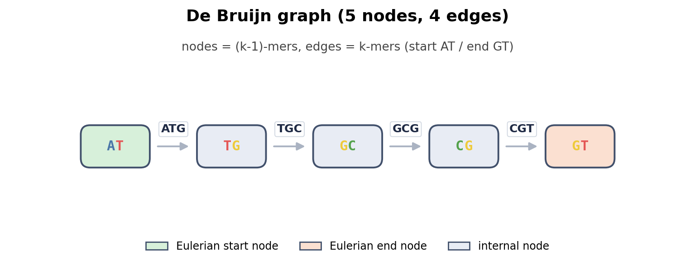
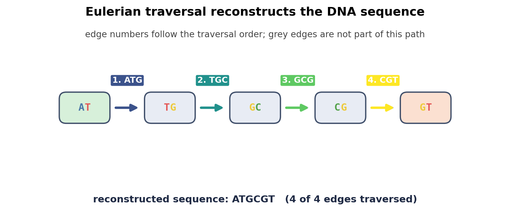
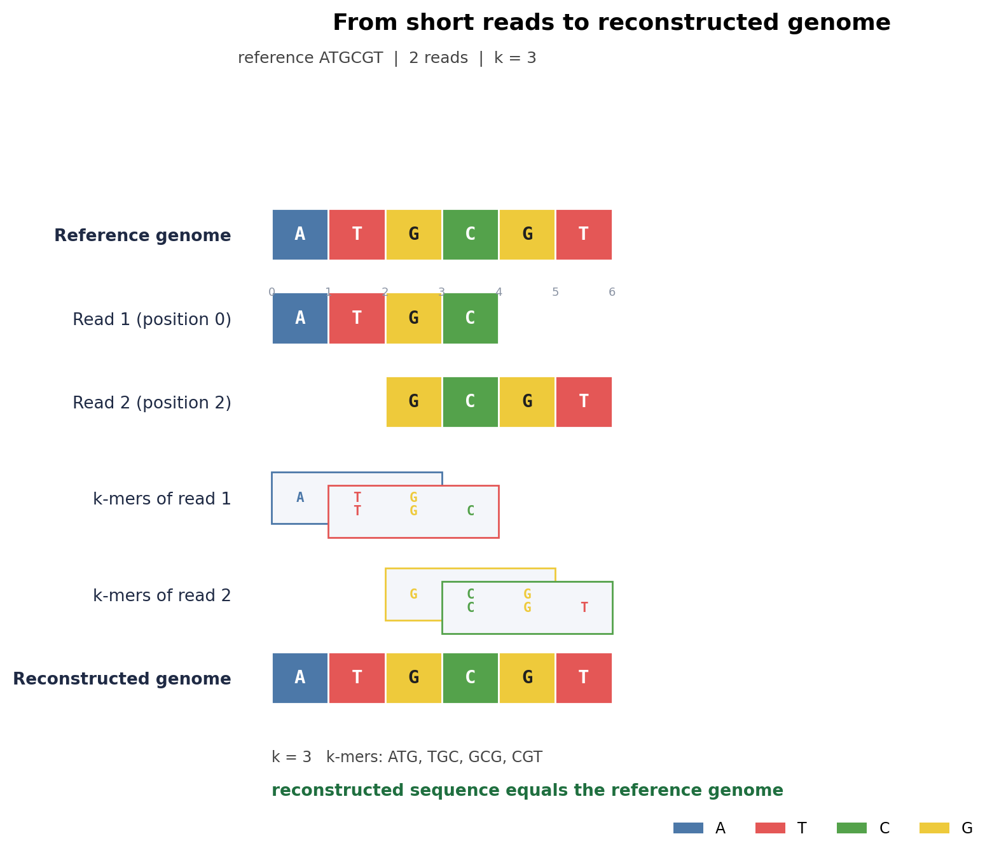

# Programming-for-Scientist-Project

Welcome! This is the 02601 Project for the Greedy Genome Gobblers. Our project is on studying genome assembly using short reads. We will be implementing, analyzing, and testing different algorithms and their accuracy and speed with different variables.

In this README.md file, you will find a list of files and their descriptions, our function and class heirarchy and description, and etc.... (to be added as more things come up)

## 0. To-Do

* [X] Setup repo and environment
* [X] Generate genome
* [X] Generate reads
* [X] Generate k-mers
* [X] Build De Bruijn graph from k-mers
* [X] Eulerian path traversal and sequence reconstruction
* [X] Deterministic synthetic dataset with known ground truth
* [X] Unit tests for generation, graph construction, and reconstruction
* [X] De Bruijn graph and traversal visualization
* [ ] Coverage-versus-accuracy experiments (future milestone)
* [ ] Accuracy evaluation with Levenshtein distance (future milestone)
* [ ] Sequencing error simulation (future milestone)

---

## 1. Files

.gitignore

- File that makes sure that when you are adding, committing, and pushing files, it ignores certain files from being saved into the remote repo.

CONTRIBUTING.md

- File that details how to setup a local git repo and python environment, save and upload your changes, and keep our changes clean and detailed.

README.md

- File containing overview of our project, including file, class, and function heirarchy, structure, and brief description.

requirements.txt

- File containing shared list of python packages to keep our python virtual environments synced and clean.

main.py

* File containing our main analysis scripts. Running it demonstrates assembly of the small synthetic dataset.

test.py

* File testing our functions with the standard library `unittest` module.

genome.py

* File containing the functions needed to generate a random genome sequence, random short reads, and k-mer list.

de_brujin.py

* File containing the `Node`, `Edge`, and `DeBruijnGraph` classes, the Eulerian path traversal, and sequence reconstruction.

graph_visualization.py

* File containing the Matplotlib figures for the graph, the Eulerian traversal, and the whole pipeline.

figures/

* Generated PNG figures used in this README. Recreate them with `python main.py --visualize`.

data/small_dataset.py

* File containing the small deterministic synthetic datasets used by `main.py` and the tests, plus documentation of the expected k-mers and assembly.

---

## 2. Function Heirarchy

### genome.py

| Function | Input | Output | Status |
| --- | --- | --- | --- |
| `generate_random_genome(g_length)` | genome length | random string over `A, T, C, G` | implemented |
| `generate_random_short_reads(genome, r_length, r_number)` | genome, read length, read count | list of `r_number` reads of length `r_length` | implemented |
| `generate_kmer(read, k_length)` | one read, k | list of overlapping k-mers of that read | implemented |
| `generate_kmers_for_read_list(read_list, k_length)` | reads, k | concatenated k-mer list for all reads | implemented |

### de_brujin.py

| Class / Function | Purpose | Status |
| --- | --- | --- |
| `Node` | one `(k-1)`-mer, with `in_edges` and `out_edges` | implemented |
| `Edge` | one k-mer, with `source` and `target` nodes | implemented |
| `DeBruijnGraph.add_kmer(kmer)` | add one k-mer as a directed edge between two `(k-1)`-mers | implemented |
| `DeBruijnGraph.find_start_node()` | validate degrees and return the Eulerian start node, or `None` | implemented |
| `eulerian_path(graph)` | Hierholzer traversal returning the ordered node path, or `None` | implemented |
| `path_to_sequence(path)` | rebuild a DNA string from an ordered node path | implemented |

### data/small_dataset.py

| Name | Contents | Status |
| --- | --- | --- |
| `SMALL_EXAMPLE` | reference `ATGCGT`, reads `["ATGC", "GCGT"]`, `k = 3` | implemented |
| `LARGER_EXAMPLE` | reference `ACGTTGCA`, reads `["ACGTT", "GTTGCA"]`, `k = 4` | implemented |
| `get_dataset(name)` | look up one fixture by name | implemented |

### graph_visualization.py

| Function | Purpose | Status |
| --- | --- | --- |
| `graph_elements(graph)` | read nodes, edges, roles, and layout out of the graph | implemented |
| `ordered_edges_for_path(graph, path)` | map an Eulerian node path onto distinct `Edge` instances | implemented |
| `visualize_debruijn_graph(graph, output_path=None)` | draw nodes, directed k-mer edges, start/end highlights | implemented |
| `visualize_eulerian_path(graph, path, output_path=None)` | draw the graph plus the numbered traversal | implemented |
| `visualize_sequence_reconstruction(reference, reads, kmers, assembled, k=None, output_path=None)` | educational four-stage pipeline figure | implemented |
| `create_all_figures(...)` | write all three PNGs into one directory | implemented |

---

## 3. How the assembly pipeline fits together

Every read is broken into k-mers. Every k-mer becomes a directed edge from its
prefix `(k-1)`-mer to its suffix `(k-1)`-mer, so shared `(k-1)`-mers automatically
join overlapping reads into one graph:

```
"ATGC" -> ATG, TGC          AT --ATG--> TG --TGC--> GC --GCG--> CG --CGT--> GT
"GCGT" -> GCG, CGT
```

Because each k-mer is used at most once, assembly is an **Eulerian path** problem
(traverse every edge exactly once), not a Hamiltonian path problem. The path is
then read back into a sequence by taking the first node in full and appending
only the last base of every following node.

## 4. Running the demonstration

```bash
python main.py
```

Expected output for the deterministic example:

```
Greedy Genome Gobblers
Milestone: De Bruijn graph assembly of a known synthetic genome
Dataset: small_6bp_2reads

Reference genome: ATGCGT
Reads: ['ATGC', 'GCGT']
K-mer length: 3

Generated k-mers:
ATG, TGC, GCG, CGT

Graph nodes: 5
Graph edges: 4

Reconstructed sequence: ATGCGT
Reconstruction successful: True
```

An optional seeded random example runs the same pipeline on a randomly generated
genome. The seed is fixed, so the run is reproducible:

```bash
python main.py --random
```

The visualization mode writes the three milestone figures described in section 6:

```bash
python main.py --visualize
```

The two flags can be combined (`python main.py --random --visualize`); the
figures always come from the deterministic fixture so that they stay reproducible.

## 5. Running the tests

```bash
python -m unittest test -v
```

The suite covers genome generation (alphabet, length, reproducibility), read
generation (count, length, substring property), k-mer generation (overlap,
edge cases), graph construction (nodes, edges, adjacency, shared nodes), the
deterministic reconstructions, duplicate k-mers being kept as separate edges,
and invalid configurations (disconnected graphs, unbalanced degrees, multiple
start nodes, empty graph).

## 6. Graph Visualization

`graph_visualization.py` only *draws* what the assembly pipeline already built.
Nodes, edges, path order, and labels are read out of the real `DeBruijnGraph`
object, so a figure can never drift away from the data structure.

```bash
python main.py --visualize
```

Output (paths are printed by the script):

```
figures/
    debruijn_graph.png
    eulerian_traversal.png
    sequence_reconstruction.png
```

The Matplotlib backend is set to `Agg`, so nothing opens a window and the figures
can be generated headlessly (server, CI, `ssh`). The layout is deterministic:
nodes are ordered by topological level, so a linear chain is drawn in a straight
row and repeated runs produce identical pixels.

### De Bruijn graph



Every node is a `(k-1)`-mer and every arrow is a k-mer pointing from its prefix to
its suffix; for `k = 3` the chain is
`AT --ATG--> TG --TGC--> GC --GCG--> CG --CGT--> GT`.
Nodes that can only start or only end an Eulerian path are coloured (green and
orange). Repeated k-mers get their own bowed arrow and self-loops are drawn as
loops, so no edge is hidden or merged.

### Eulerian traversal



The same graph with the traversal drawn on top: each used edge is numbered in
traversal order and coloured along a gradient, unused edges stay grey. The
reconstructed sequence is printed under the figure. When the graph has no valid
Eulerian path, the figure says so instead of drawing an invented route.

`eulerian_path()` returns `Node` objects, not edges. `ordered_edges_for_path()`
resolves each step to the actual `Edge` instance by consuming a private copy of
each node's `out_edges`, so two identical k-mers are never mapped to the same
edge and the graph itself is never modified.

### Sequence reconstruction



The four stages of the pipeline on one set of nucleotide blocks, using the same
base colours throughout: the reference genome, the input reads placed at their
position, the k-mers of each read drawn as an offset staircase to show the `k-1`
overlap, and the reconstructed genome. A read is only placed at a coordinate when
its position is unambiguous; ambiguous reads are listed separately instead of
being given a made-up origin.

### Why a valid traversal is not a correct assembly

The traversal in the second figure uses every observed k-mer exactly once — and
that is all it proves. It does not prove the sequence is the original genome. A
graph can accept a valid Eulerian path while still being wrong: uncovered regions
leave gaps or separate components, repeats create branches with several legal
routes, and sequencing errors create k-mers that never existed in the DNA. The
figures therefore show two different questions side by side: which ordering of
edges the graph admits, and whether the assembled sequence matches the known
reference.

## 7. The synthetic dataset

`data/small_dataset.py` holds the fixtures. The primary one is:

* reference genome: `ATGCGT`
* reads: `["ATGC", "GCGT"]`
* k: `3`
* k-mers: `ATG, TGC, GCG, CGT`
* expected assembly: `ATGCGT`

The datasets are hand-written constants, not downloaded data and not random
samples. No external dataset, network access, or multi-thousand-sequence
simulation is used, and `--random` reseeds with a fixed value so results do not
drift between runs.

## 8. Current limitations of the assembler

* **No error correction.** Reads must be exact substrings of the genome; any
  sequencing error creates false k-mers and extra branches.
* **No graph simplification.** Unitigs, bubbles, and tips are not merged or
  removed.
* **One path only.** The current traversal returns one Eulerian path and stops.
  It does not enumerate alternative paths through ambiguous branches.
* **Repeats are not resolved.** A repeated sequence region produces two
  identical edges, and both are used. With `ATA, TAT, ATA` the reconstruction is
  `ATATA`, not `ATAT`, because the observed repeat is traversed twice. A short
  read set cannot distinguish one copy from two.
* **No coverage handling.** Uneven coverage is invisible to the graph, so low or
  zero coverage regions simply appear as missing edges or disconnected
  components.
* **Duplicate k-mer degree caveat.** Parallel edges can push a node's degree
  difference beyond `±1`, and such a graph is correctly reported as having no
  Eulerian path rather than being silently "repaired".
* **No accuracy metrics.** There is no Levenshtein distance, no coverage sweep,
  and no statistics yet.

## 9. Deliberately unfinished (future milestones)

* Coverage-versus-accuracy experiments and parameter sweeps over k.
* Levenshtein-distance based accuracy evaluation, means, and standard deviations.
* Sequencing error simulation and error correction.
* Graph simplification (bubble and tip removal, unitig compaction).
* Alternative genome models (different base distributions, Markov chains).
* Hamiltonian-path comparison and a hybrid assembly algorithm.
* Performance benchmarking, final scientific figures, and the final report.

## 10. Why an Eulerian path is not a proof of correct assembly

A single Eulerian path through all observed read-derived k-mers only means the
observed k-mer multiset admits one ordering. It does not mean that ordering is
the genome. Random sampling can drop overlaps, leaving disconnected components
or unbalanced degrees; repeats create branches with several valid paths; and
errors create k-mers that never existed in the original DNA. In those cases the
graph often admits *some* path, but the path is one of many possibilities, so the
reconstructed sequence can differ from the true genome even when no code error
occurred. The tests therefore separate two questions: does the traversal use
every edge exactly once, and does the assembled sequence match the known
reference. Only the second question is a claim about accuracy.
